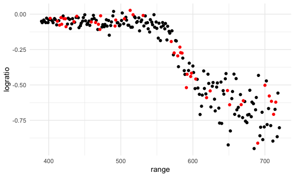

Cross Validation
================

``` r
library(tidyverse)
library(p8105.datasets)
library(modelr)
library(mgcv)
```

    ## Loading required package: nlme

    ## 
    ## Attaching package: 'nlme'

    ## The following object is masked from 'package:dplyr':
    ## 
    ##     collapse

    ## This is mgcv 1.9-4. For overview type '?mgcv'.

## LIDAR data

``` r
data("lidar")

lidar_df = lidar |> 
  mutate(id = row_number()) |> 
  select(id, everything())

lidar_df |> 
  ggplot(aes(x = range, y = logratio)) + 
  geom_point()
```


Build my training testing datasets

``` r
train_df = sample_frac(lidar_df, size = 0.8)
test_df = anti_join(lidar_df, train_df, by = "id")
```

``` r
ggplot(train_df, aes(x = range, y = logratio)) + 
  geom_point() + 
  geom_point(data = test_df, color = "red")
```



fit some models

``` r
linear_mod = lm(logratio ~ range, data = train_df)
smooth_mod = gam(logratio ~ s(range), data = train_df)
wiggly_mod = gam(logratio ~ s(range, k = 30), sp = 10e-6, data = train_df)
```

Make a plot

``` r
train_df |> 
  add_predictions(wiggly_mod) |> 
  ggplot(aes(x = range, y = logratio)) +
  geom_point() +
  geom_line(aes(y = pred), color = "red")
```


Do a model comparison

``` r
rmse(linear_mod, test_df)
```

    ## [1] 0.1114619

``` r
rmse(smooth_mod, test_df)
```

    ## [1] 0.07057548

``` r
rmse(wiggly_mod, test_df)
```

    ## [1] 0.0779629
