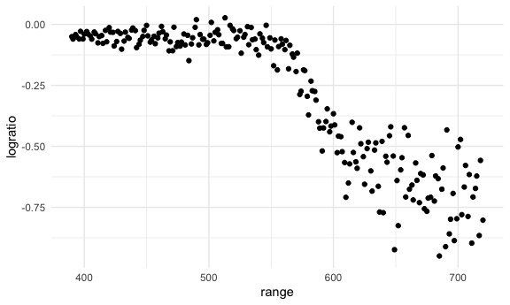
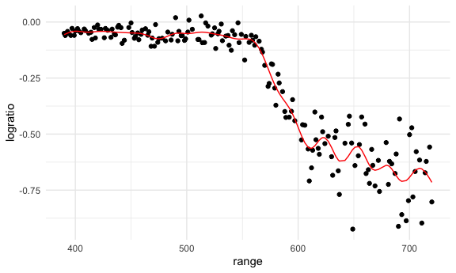
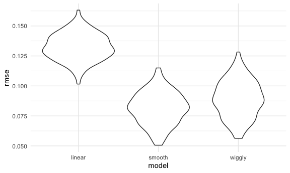
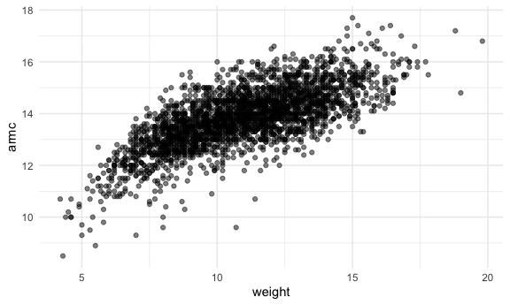
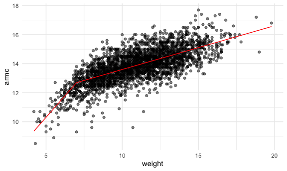
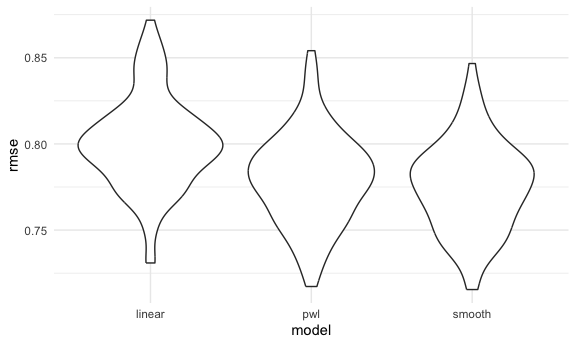

Cross Validation
================

``` r
library(tidyverse)
library(p8105.datasets)
library(modelr)
library(mgcv)
```

    ## Loading required package: nlme

    ## 
    ## Attaching package: 'nlme'

    ## The following object is masked from 'package:dplyr':
    ## 
    ##     collapse

    ## This is mgcv 1.9-4. For overview type '?mgcv'.

## LIDAR data

``` r
data("lidar")

lidar_df = lidar |> 
  mutate(id = row_number()) |> 
  select(id, everything())

lidar_df |> 
  ggplot(aes(x = range, y = logratio)) + 
  geom_point()
```



Build my training testing datasets

``` r
train_df = sample_frac(lidar_df, size = 0.8)
test_df = anti_join(lidar_df, train_df, by = "id")
```

``` r
ggplot(train_df, aes(x = range, y = logratio)) + 
  geom_point() + 
  geom_point(data = test_df, color = "red")
```


fit some models

``` r
linear_mod = lm(logratio ~ range, data = train_df)
smooth_mod = gam(logratio ~ s(range), data = train_df)
wiggly_mod = gam(logratio ~ s(range, k = 30), sp = 10e-6, data = train_df)
```

Make a plot

``` r
train_df |> 
  add_predictions(wiggly_mod) |> 
  ggplot(aes(x = range, y = logratio)) +
  geom_point() +
  geom_line(aes(y = pred), color = "red")
```



Do a model comparison

``` r
rmse(linear_mod, test_df)
```

    ## [1] 0.142209

``` r
rmse(smooth_mod, test_df)
```

    ## [1] 0.09002299

``` r
rmse(wiggly_mod, test_df)
```

    ## [1] 0.09659756

## Repeat a bunch of times

Use some nice tools

``` r
cv_df = 
  crossv_mc(lidar, 100)

cv_df |> pull(train) |> nth(3) |> as_tibble()
```

    ## # A tibble: 176 × 2
    ##    range logratio
    ##    <dbl>    <dbl>
    ##  1   390  -0.0504
    ##  2   393  -0.0419
    ##  3   394  -0.0510
    ##  4   396  -0.0599
    ##  5   397  -0.0284
    ##  6   400  -0.0399
    ##  7   402  -0.0294
    ##  8   405  -0.0476
    ##  9   406  -0.0604
    ## 10   409  -0.0382
    ## # ℹ 166 more rows

``` r
cv_df = 
  crossv_mc(lidar, 100) |> 
  mutate(train = map(train, as_tibble),
         test = map(test, as_tibble)
         )
```

let’s fit models and get rmses for these

``` r
cv_df = 
  cv_df |> 
  mutate(
    linear_fit = map(train, \(df) lm(logratio ~ range, data = df)),
    smooth_fit = map(train, \(df) gam(logratio ~ s(range), data = df)),
    wiggly_fit = map(train, \(df) gam(logratio ~ s(range, k = 30), sp = 10e-6, data = df))
  ) |> 
  mutate(
    rmse_linear = map2_dbl(linear_fit, test, rmse),
    rmse_smooth = map2_dbl(smooth_fit, test, rmse),
    rmse_wiggly = map2_dbl(wiggly_fit, test, rmse)
  )
```

Look at this!!

``` r
cv_df |> 
  select(starts_with("rmse_")) |> 
  pivot_longer(
    everything(),
    names_to = "model",
    names_prefix = "rmse_",
    values_to = "rmse"
  ) |> 
  ggplot(aes(x = model, y = rmse)) + 
  geom_violin()
```



## Child growth

``` r
growth_df = read_csv("data/nepalese_children.csv") |> 
  mutate(
    weight_ch7 = (weight > 7) * (weight - 7)
  )
```

    ## Rows: 2705 Columns: 5
    ## ── Column specification ────────────────────────────────────────────────────────
    ## Delimiter: ","
    ## dbl (5): age, sex, weight, height, armc
    ## 
    ## ℹ Use `spec()` to retrieve the full column specification for this data.
    ## ℹ Specify the column types or set `show_col_types = FALSE` to quiet this message.

look at this

``` r
growth_df |> 
  ggplot(aes(x = weight, y = armc)) + 
  geom_point(alpha = 0.5)
```



``` r
linear_fit = lm(armc ~ weight, data = growth_df)
pwl_fit = lm(armc ~ weight + weight_ch7, data = growth_df)
smooth_fit = gam(armc ~ s(weight), data = growth_df)
```

``` r
growth_df |> 
  add_predictions(pwl_fit) |> 
  ggplot(aes(x = weight, y = armc)) +
  geom_point(alpha = 0.5) +
  geom_line(aes(y = pred), color = "red")
```



Do all the cross validation stuff we know and love

``` r
cv_df = 
  crossv_mc(growth_df, 100) |> 
  mutate(train = map(train, as_tibble),
         test = map(test, as_tibble)
  )
```

here i’m fitting models and getting rmses

``` r
cv_df = 
  cv_df |> 
  mutate(
    linear_fit = map(train, \(df) lm(armc ~ weight, data = df)),
    pwl_fit = map(train, \(df) lm(armc ~ weight + weight_ch7, data = df)),
    smooth_fit = map(train, \(df) gam(armc ~ s(weight), data = df)),
  ) |> 
  mutate(
    rmse_linear = map2_dbl(linear_fit, test, rmse),
    rmse_pwl = map2_dbl(pwl_fit, test, rmse),
    rmse_smooth = map2_dbl(smooth_fit, test, rmse)
  )
```

``` r
cv_df |> 
  select(starts_with("rmse_")) |> 
  pivot_longer(
    everything(),
    names_to = "model",
    names_prefix = "rmse_",
    values_to = "rmse"
  ) |> 
  ggplot(aes(x = model, y = rmse)) + 
  geom_violin()
```


